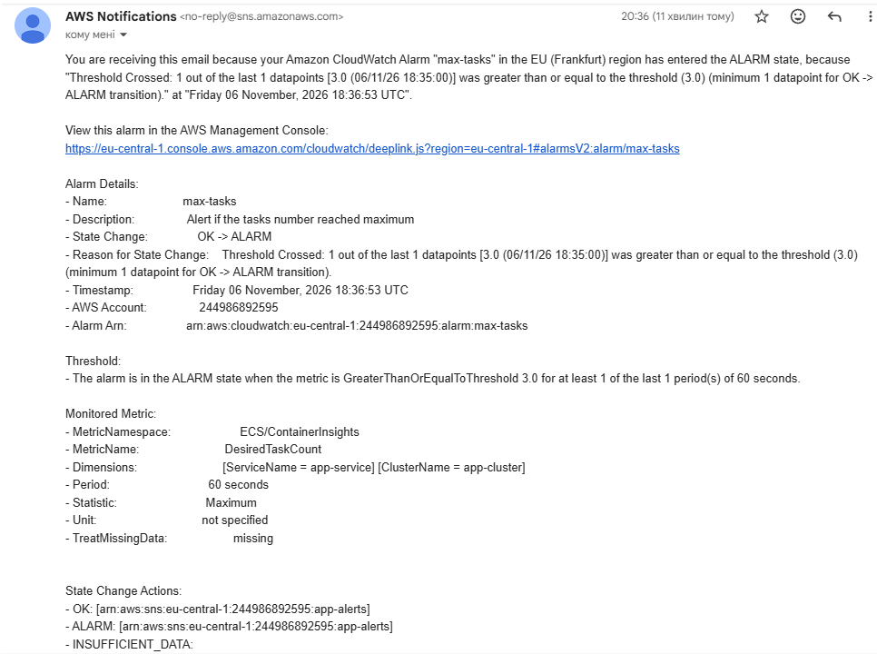
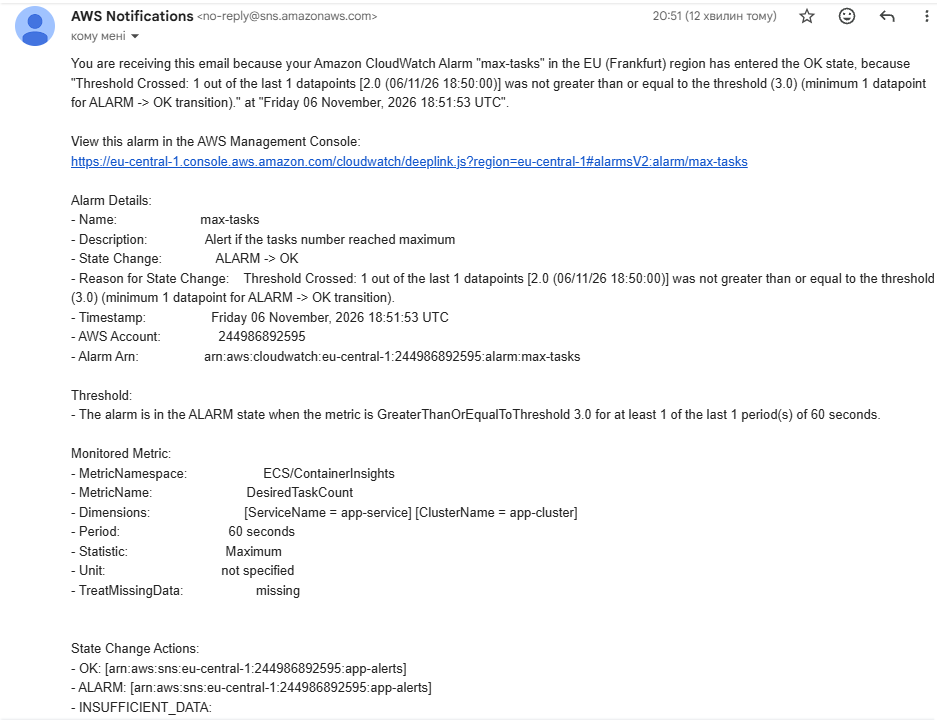

# Сповіщення

Сповіщення налаштовано на спрацьовування, коли бажана кількість екземплярів досягає або перевищує максимальне значення - 3 - протягом 1 періоду (60 секунд). Друге сповіщення надсилається після повернення до норми.

Обґрунтування: кількість екземплярів зростає при збільшенні навантаження, але їх кількість обмежена максимальним значенням. Досягнення порогу означає, що вичерпано можливості автоматичного масштабування. Таке сповіщення дозволяє виявити можливу нестачу ресурсів і за потреби відреагувати на неї.

### Лист ALARM

### Лист OK

## Час реакції та його оцінка

Початок сталого навантаження: 18:18
Досягнення максимальної кількості екземплярів: 18:34
Отримання листа ALARM: 18:36
Отримання листа OK: 18:51

Від початку сталого навантаження до отримання першого листа ALARM минуло приблизно 18 хвилин. Максимальна кількість екземплярів була досягнута о 18:34 UTC, тому сповіщення надійшло приблизно через 2 хвилини після вичерпання встановленого ліміту. Другий лист (OK) надійшов о 18:51 UTC — приблизно через хвилину після початку зменшення кількості екземплярів.

Для критичних систем реального часу, чутливих до затримок такий час не підходить. У таких випадках очікування фактичного досягнення порогу максимальної кількості екземплярів означає деградацію сервісу для користувачів. Для таких застосунків варто все ж таки налаштовувати сповіщення при перетині CPU порогу в певний відсоток, або при високій швидкості зростання запитів, щоб можна було зреагувати до того, як автомасштабування досягне межі. Водночас для звичайних інформаційних систем, де сповіщення про досягнення максимальної кількості екземплярів потрібне переважно для контролю ресурсів, такий час реакції може бути прийнятним.