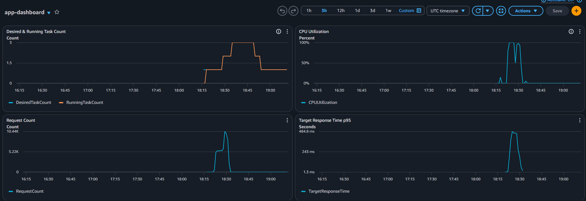
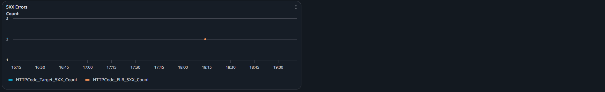

# Автоматичне масштабування

| Параметр | Значення |
|---|---|
| Цільова метрика | Середнє завантаження процесора |
| Цільове значення | 60 % |
| Мінімум екземплярів | 1 |
| Максимум екземплярів | 3 |
| Період стабілізації при додаванні | 60 с |
| Період стабілізації при вилученні | 180 с |

Цільове значення 60 % обрано для того, щоб залишався запас для обробки запитів під час пікових навантажень. Оскільки на запуск нового контейнера потрібен час на завантаження образу, ініціалізація застосунку, проходження health checks тощо, при вищому порозі поточні екземпляри можуть почати видавати помилки ще до того, як нові будуть готові приймати запити.

## Період стабілізації 

Період стабілізації — це час, протягом якого система автомасштабування провайдера "чекає" після виконання масштабування, перш ніж робити наступне. Це дає змогу уникнути частих змін кількості задач через короткочасні коливання навантаження.

**Що станеться, якщо встановити cooldown рівним нулю?**

Якщо поставити період стабілізаіції рівним нулю, то сервіс може перейти в стан нестабільного масштабування (flapping).
Як тільки середній CPU перевищить 60%, AWS дасть команду на додавання одного екземпляра. Оскільки паузи нема, а перший новий контейнер ще не встиг запуститися і перебрати на себе частину трафіку, середнє навантаження CPU буде лишатись вищим за 60%.
AWS буде ініціювати додавання наступних екземплярів, поки не досягне ліміту max_capacity. Аналогічно, при спаді навантаження нижче порогу AWS буде ініціювати видалення контейнерів без затримки, що призведе до коливань кількості задач.

## Панель моніторингу

## Аналіз масштабування

Початок навантаження: приблизно 18:18 (за UTC).
Перетин порогу: 18:21. Використання CPU в цей момент зросло до більше, ніж 75%.
Поява другого екземпляру: 18:29. Приблизно на хвилину використання впало до рівня 50%, але відразу ж продовжило зростати.
Поява третього екземпляру: 18:34. Використання почало спадати, завершення тесту - близько 18:36.
Вилучення екземплярів: 18:50 - зменшенн кількості екземплярів з 3 до 2, 18:53 - з 2 до 1.

### Чому між перетином порогу і появою екземпляра минає час

Затримка між перетином порогу CPU та появою нового екземпляра зумовлена часом, необхідним для збору й аналізу метрик CloudWatch, щоб підтвердити стійке зростання навантаження. Також ECS потрібен час для виділення обчислювальних ресурсів, завантаження образу з ECR, запуску контейнера та проходження health checks балансувальника.

### Чому вилучення відбувається повільніше

Вилучення екземплярів відбувається повільніше, ніж їх додавання, бо AWS намагається уникнути передчасного зменшення ресурсів через короткочасне падіння навантаження. Політика TargetTracking орієнтується на цільове значення завантаження CPU, тож для зменшення кількості задач значення метрики має триматися нижче порогу протягом певного часу. Саме тому вилучення екземплярів відбулося приблизно через 15 хвилин після завершення тесту — це зумовлено також базовими налаштуваннями CloudWatch, які вимагають певного часу утримання низького значення. Крім того, враховується налаштований період стабілізації - 180 секунд, який запобігає надто частому масштабуванню. Також еред видаленням балансувальник ALB припиняє надсилати нові запити та дає змогу завершити поточні з'єднання.