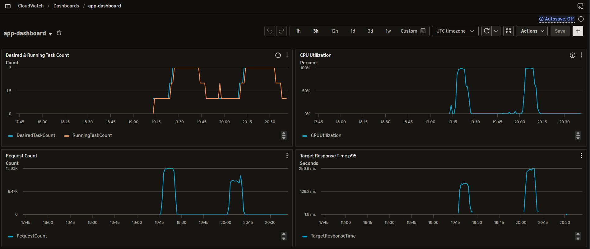
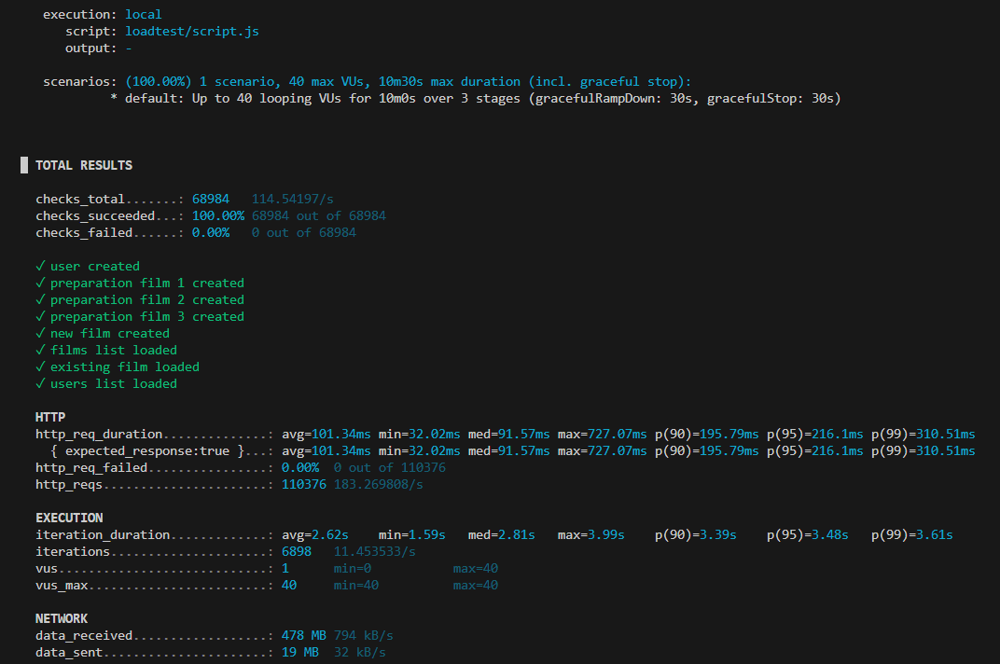
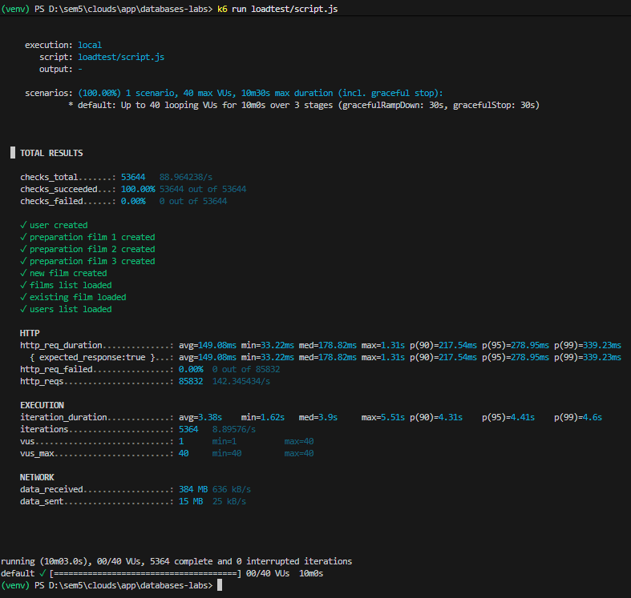

Результати:

Показник Без кешу/З кешем 
Запитів за тест 85 832 / 110 376 
Запитів за секунду 142.345434/s / 183.269808/s 
Затримка p50 178.82ms / 91.57ms 
Затримка p95 278.95ms / 216.1ms 
Затримка p99 339.23ms / 310.51ms 
CPU бази, середнє 9.52% / 10.88%
Відсоток влучань у кеш: 88.73%

### Вивід тестів на дашборді

### Вивід у терміналі з увімкненим кешем

### Вивід у терміналі з вимкненим кешем

