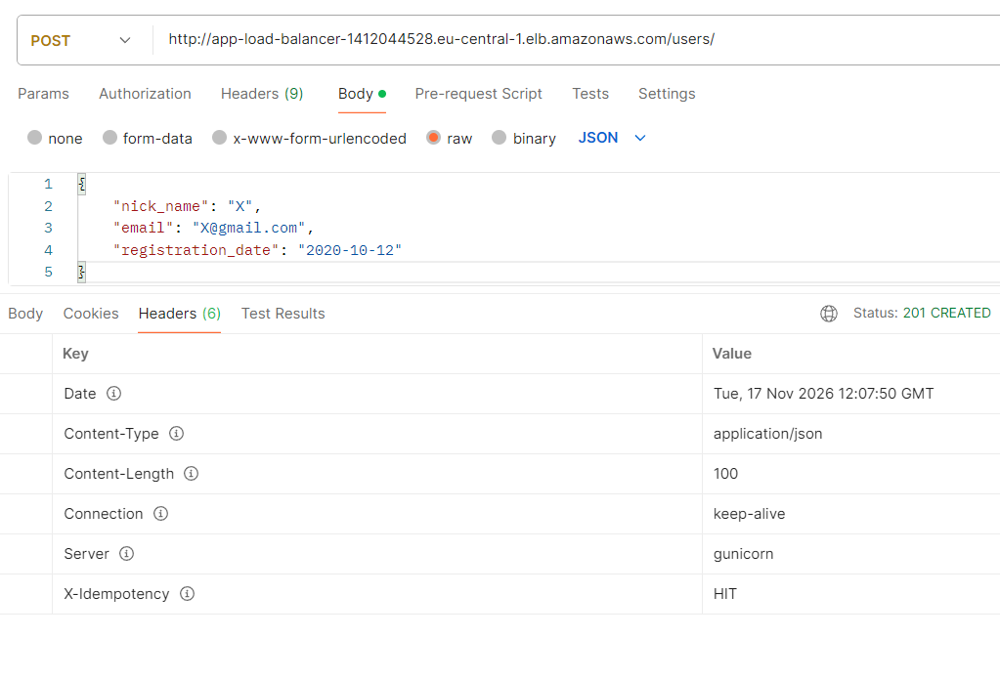

Для синхронної операції створення користувача (`POST /users/`) реалізовано підтримку HTTP-заголовка Idempotency-Key зі збереженням результатів у Redis на 24 години.

### Яку проблему це розв'язує
- При мережевих збоях, таймаутах балансувальника або повторних кліках користувача клієнт може повторно надіслати той самий запит на створення ресурсу. Без ідемпотентності повторний запит призвів би до створення дублікатів у базі даних або помилки конфлікту.
- Із заголовком Idempotency-Key перший запит виконується, а його HTTP-статус і тіло відповіді кешуються в Redis. Усі повторні запити з тим самим ключем протягом 24 годин повертають збережену відповідь без повторного звернення до бізнес-логіки та БД.

### Як це поєднується із завданням 6 (черги повідомлень)
Якщо операція створення пройшла успішно і об'єкт є в БД, але відповідь 202 чомусь не дійшла до клієнта (через збій мережі), він, імовірно, зробить ще один запит. Тоді у черзі опинилося б 2 однакових повідомлення, що могло б спровокувати конфлікти або спроби повторного запису в БД. Якщо на рівні API реалізовано ідемпотентність для цього запиту через `Idempotency-Key`, повторний запит поверне збережену з Redis відповідь 202 без надсилання другого повідомлення в чергу SQS.

Якщо клієнт надіслав запит лише один раз, сама черга SQS працює за принципом at-least-once. Наприклад, Worker прочитав повідомлення, записав відгук у БД, але перед командою `DeleteMessage` пропала мережа або процес було перезапущено. Після спливу `VisibilityTimeout` SQS віддасть це повідомлення іншому Worker-у вдруге. За наявності ідемпотентності (через перевірку ключа в Redis або складений первинний ключ `(film_id, user_id)` у БД) Worker виявляє, що операцію вже опрацьовано, пропускає повторний запис і видаляє повідомлення з черги.

