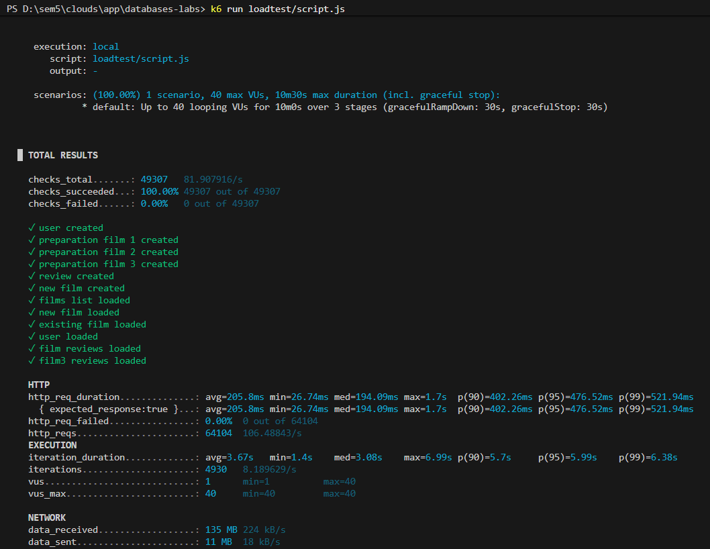

## Опис

Кожен віртуальний користувач за одну ітерацію робить 1 запис і 9 читань: створює новий фільм (POST /films), потім читає загальний список фільмів (2 рази), щойно створений фільм (GET /films/:id), інші існуючі фільми (2 рази), дані користувача (GET /users/:id) та відгуки до фільмів (3 рази через GET /reviews/film/:id).

Перед початком тесту у фазі setup() створюються тестовий користувач, три фільми та відгуки до них, щоб GET-запити мали реальні дані для читання.

## Фази навантаження
- Зростання від 0 до 40 користувачів за 2 хвилини.
- Утримання 40 користувачів - 5 хвилин.
- Спад до 0 за 3 хвилини.

## Команда запуску

```bash
k6 run loadtest/script.js
```

## Результати тестування

| Показник | Значення |
|---|---|
| Кількість запитів | 64104 |
| Кількість запитів за секунду | 106.5 |
| Невдалі запити | 0 (0.00 %) |
| Затримка p50 | 194.09 мс |
| Затримка p95 | 476.52 мс |
| Затримка p99 | 521.94 мс |

