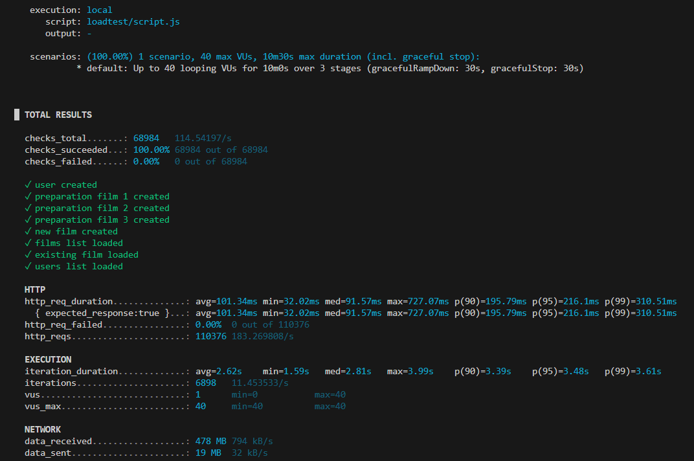

## Опис

Кожен віртуальний користувач за одну ітерацію виконує операції запису та читання: створює новий фільм (POST /films), після чого виконує серію читань - завантажує загальний список фільмів (5 разів через GET /films), переглядає кожен із попередньо підготовлених під час setup() існуючих фільмів (GET /films/:id) та завантажує загальний список користувачів (GET /users/).

У фазі setup() створюються тестовий користувач і три базові фільми, щоб GET-запити мали актуальні дані для перевірки.

## Фази навантаження
- Зростання від 0 до 40 користувачів за 2 хвилини.
- Утримання 40 користувачів - 5 хвилин.
- Спад до 0 за 3 хвилини.

## Команда запуску

```bash
k6 run loadtest/script.js
```

## Результати тестування

| Показник | Значення |
|---|---|
| Кількість запитів | 110 376|
| Кількість запитів за секунду | 183.27 |
| Невдалі запити | 0 (0.00 %) |
| Затримка p50 | 91.57 мс |
| Затримка p95 | 216.10 мс |
| Затримка p99 | 310.51 мс |

