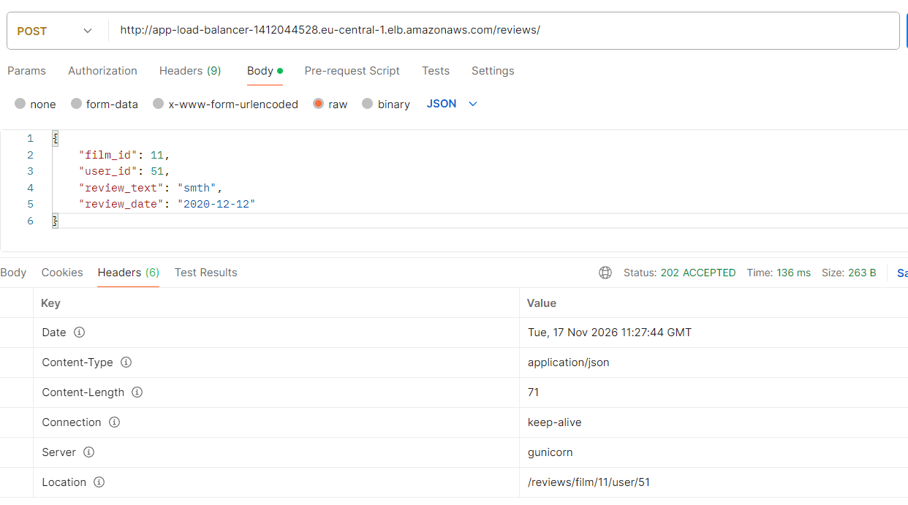
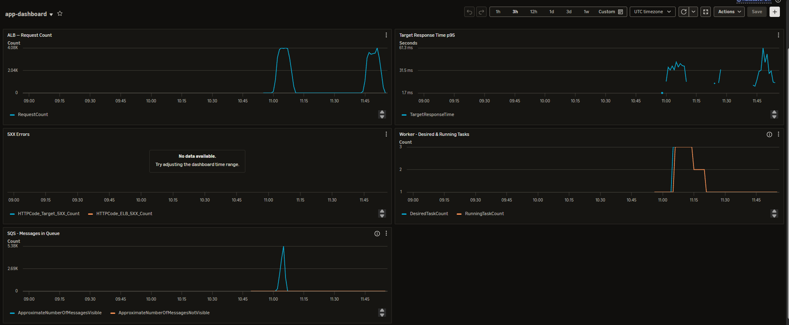

Операцію створення відгуку (`POST /reviews/`) переведено на асинхронну модель обробки через Amazon SQS.

Основний API-сервіс приймає запит, виконує валідацію даних, надсилає повідомлення до черги SQS та повертає клієнту відповідь 202 Accepted. Фактичний запис відгуку в базу даних виконує окремий контейнер-обробник (Worker), який отримує повідомлення з черги та обробляє його.

## Що змінилося для клієнта

- Замість синхронного виконання операції та повернення `201 Created` після успішного запису в базу даних клієнт отримує `202 Accepted`. Цей статус означає, що запит прийнято до обробки, але операція ще не обов'язково завершена.

- Стабільна латентність під навантаженням. API не очікує завершення запису в базу даних, оскільки передає цю операцію окремому Worker. Завдяки цьому час відповіді API менше залежить від швидкості виконання операцій із БД та інтенсивності навантаження.

## Як клієнт дізнається результат обробки

Оскільки відповідь `202 Accepted` не означає, що відгук уже створено, API повертає HTTP-заголовок Location, який містить адресу ресурсу, за якою можна перевірити наявність створеного відгуку. Клієнт використовує механізм Polling - надсилає GET-запит за адресою з заголовка Location.

## Доставка повідомлень щонайменше один раз

Модель доставки At-least-once delivery означає гарантію доставки повідомлення щонайменше один раз. Водночас через особливості розподіленої системи одне й те саме повідомлення може бути доставлене обробнику повторно.

Наприклад, повторна доставка можлива, якщо Worker не встиг видалити повідомлення з черги до завершення часу його невидимості або завершив роботу під час обробки повідомлення. Після отримання повідомлення Worker виконує операцію запису в БД. Якщо обробка завершилася успішно, він надсилає DeleteMessage, щоб видалити повідомлення з черги. Якщо виникла тимчасова помилка, повідомлення не видаляється та може бути доставлене повторно після завершення VisibilityTimeout.

Для повідомлень, які не вдалося успішно обробити після встановленої кількості спроб, використовується Dead-Letter Queue.

## Повторна обробка повідомлень

Унікальність відгуку гарантує складений первинний ключ (`film_id`, `user_id`) у таблиці відгуків.

Якщо відгук для цієї пари вже існує, сервісний шар викидає `ReviewExistsException`. Worker вважає повідомлення успішно обробленим і видаляє його з черги через `DeleteMessage`. Якщо два екземпляри Worker обробляють те саме повідомлення одночасно, дублікат відсікає первинний ключ: Worker відкочує транзакцію, перевіряє, що запис існує, і також видаляє повідомлення.
Навіть за кількох доставок одного повідомлення в базі буде лише один відгук. 
Це ідемпотентна обробка на боці БД, вона відрізняється від `Idempotency-Key` із завдання 7, де ідемпотентність працює через кеш Redis.

## Тестування

Для перевірки проведено два тести по 10 хвилин: з чергою SQS (11:00–11:10 UTC) і з прямим записом у БД (11:45–11:55 UTC). Помилок 5XX в обох тестах не було.

| Показник | З чергою SQS | Без черги |
|---|---:|---:|
| Пікова латентність API (p95) | 31,3–38,6 мс | 61,3 мс |
| Пікова глибина черги | 5 377 повідомлень | 0 |

Із чергою латентність API стабільно нижча (p95 до 38,6 мс проти 61,3 мс), бо API лише ставить повідомлення в чергу, а запис у БД виконує Worker.

О 11:05 глибина черги досягла піку і о 11:06 політика масштабування збільшила кількість Worker з 1 до 3. Після спаду навантаження черга спорожніла, кількість екземплярів Worker зменшилася до 2 (11:15) і до 1 (11:21), з урахуванням періоду стабілізації (cooldown).
